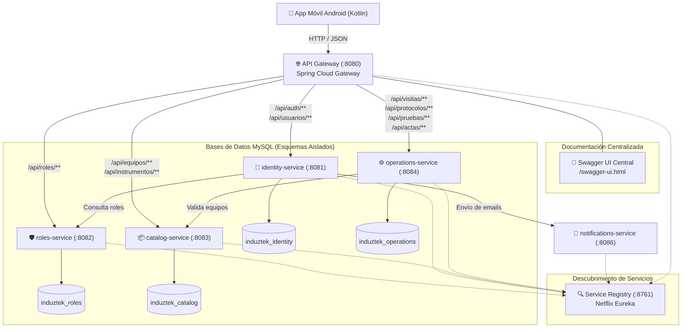

# 🚀 Induztek - Ecosistema de Microservicios Backend

Backend empresarial desarrollado en **Java 21** y **Spring Boot 3.5**, estructurado bajo una arquitectura de microservicios distribuidos con **Spring Cloud Gateway**, registro y descubrimiento dinámico con **Netflix Eureka**, bases de datos independientes en **MySQL 8.4** y documentación interactiva centralizada en **Swagger UI / OpenAPI 3**.

---

## 🏛️ Arquitectura del Sistema



---

## 📦 Módulos y Microservicios

El repositorio está organizado en un proyecto Maven multimódulo:

| Módulo | Puerto | Base de Datos | Descripción |
|---|:---:|:---:|---|
| **`api-gateway`** | `8080` | - | Único punto de entrada HTTP. Enruta tráfico a los microservicios y expone la Swagger UI centralizada. |
| **`service-registry`** | `8761` | - | Servidor Eureka para registro y balanceo dinámico de instancias. |
| **`common-security`** | - | - | Biblioteca compartida con autoconfiguración de decodificación JWT (`NimbusJwtDecoder`). |
| **`roles-service`** | `8082` | `induztek_roles` | Gestión del catálogo de roles, descripciones y perfiles de usuario. |
| **`identity-service`** | `8081` | `induztek_identity` | Registro, login, emisión de tokens JWT, aprobación de cuentas, recuperación de contraseña y fotos de perfil. |
| **`catalog-service`** | `8083` | `induztek_catalog` | Inventario de equipos técnicos (transformadores, interruptores) e instrumental con control de calibración. |
| **`operations-service`** | `8084` | `induztek_operations` | Gestión de visitas en terreno, protocolos de prueba, mediciones eléctricas en JSON, actas y fotos de respaldo. |
| **`notifications-service`**| `8086` | - | Microservicio interno para envío de correos transaccionales vía SMTP (Spring Mail). |

---

## 📑 Documentación de la API (Swagger / OpenAPI 3)

Todos los controladores y endpoints cuentan con especificación **OpenAPI 3 / Swagger**:

### ¿Cómo acceder a Swagger UI?
Una vez levantado el entorno, abre en tu navegador:

👉 **[http://localhost:8080/swagger-ui.html](http://localhost:8080/swagger-ui.html)**

### Funcionalidades de Swagger UI:
1. **Selector de Microservicio:** En la esquina superior derecha, usa el menú desplegable para alternar entre:
   - *Identidad y usuarios*
   - *Roles*
   - *Catálogo*
   - *Operaciones*
   - *Notificaciones*
2. **Autenticación JWT Integrada (Botón `Authorize 🔒`):**
   - Ejecuta `POST /api/auth/login` con tus credenciales.
   - Copia el valor del campo `token`.
   - Haz clic en el botón verde **Authorize** arriba a la derecha.
   - Pega el token y haz clic en **Authorize**. Todos los endpoints protegidos usarán automáticamente el Bearer token.

---

## 🔐 Seguridad y Roles del Sistema

* **Algoritmo de Firma:** Los tokens JWT son firmados con algoritmo **HMAC-SHA256 (HS256)** mediante la clave compartida `JWT_SECRET` (mínimo 32 bytes).
* **Cifrado de Contraseñas:** Se utiliza **BCrypt** para el almacenamiento de claves.
* **Aislamiento Multitenant (Clientes):** Los usuarios con rol `CLIENT` solo pueden visualizar equipos, visitas, protocolos y actas pertenecientes a su propia empresa (`company`).

### Roles Disponibles

| Código | Perfil | Permisos Principales |
|---|---|---|
| `P-01` | **`FIELD_TECHNICIAN`** | Registro de visitas en terreno, creación de protocolos y carga de mediciones/fotos. |
| `P-02` | **`TEST_ENGINEER`** | Revisión de protocolos, ejecución de pruebas eléctricas y formalización técnica. |
| `P-03` | **`ADMIN`** | Administración completa de usuarios, aprobación de cuentas, asignación de roles y formalización. |
| `P-04` | **`CLIENT`** | Consulta exclusiva de equipos, visitas y actas de su empresa. |

---

## 🛠️ Puesta en Marcha Local

### Prerrequisitos
- **Docker Desktop** (con Docker Compose v2)
- Puerto `8080` (Gateway), `8761` (Eureka) y `3306` (MySQL) disponibles

### Paso 1: Configurar Variables de Entorno
Copia el archivo de ejemplo y edita las claves:
```bash
cp .env.example .env
```
Configura valores seguros en `.env` (especialmente `JWT_SECRET` con más de 32 caracteres y las contraseñas de MySQL).

### Paso 2: Compilar y Levantar con Docker Compose
```bash
docker compose up --build
```

### Paso 3: Verificar Estado
- **API Gateway:** [http://localhost:8080/actuator/health](http://localhost:8080/actuator/health)
- **Eureka Dashboard:** [http://localhost:8761](http://localhost:8761)
- **Swagger UI Central:** [http://localhost:8080/swagger-ui.html](http://localhost:8080/swagger-ui.html)

---

## 📱 Conexión con la App Móvil Android

La aplicación cliente de Android debe apuntar exclusivamente a la URL del **API Gateway** (puerto `8080`), nunca directamente a los microservicios individuales ni a MySQL:

* **Emulador Android Studio:** `http://10.0.2.2:8080/`
* **Dispositivo Físico (misma red Wi-Fi):** `http://<TU_IP_LOCAL>:8080/` (ej: `http://192.168.1.50:8080/`)
* **Túnel Remoto (VS Code / DevTunnels / ngrok):** Configurar la URL HTTPS pública en `PUBLIC_BASE_URL` y en la propiedad `INDUZTEK_API_BASE_URL` de la app móvil.

---

## 📋 Catálogo Completo de Endpoints

### 👤 Identidad y Autenticación (`identity-service` vía Gateway)
- `POST /api/auth/register` — Registro de nueva cuenta.
- `POST /api/auth/login` — Autenticación y obtención de JWT.
- `POST /api/auth/password/recovery` — Solicitud de código de recuperación por email.
- `POST /api/auth/password/verify` — Validación de código de 6 dígitos.
- `POST /api/auth/password/reset` — Restablecimiento de contraseña.
- `GET /api/usuarios/me` — Consulta del perfil autenticado.
- `PATCH /api/usuarios/me/perfil` — Edición de datos personales y biografía.
- `GET /api/usuarios` — Listar todos los usuarios (`ROLE_ADMIN`).
- `PATCH /api/usuarios/{id}/estado` — Aprobar o deshabilitar cuenta (`ROLE_ADMIN`).
- `PATCH /api/usuarios/{id}/rol` — Modificar rol de usuario (`ROLE_ADMIN`).
- `DELETE /api/usuarios/{id}` — Eliminar cuenta (`ROLE_ADMIN`).
- `POST /api/imagenes` — Subida de foto de perfil (Multipart).
- `GET /api/imagenes/{filename}` — Descarga de imagen.

### 🛡️ Roles y Perfiles (`roles-service` vía Gateway)
- `GET /api/roles` — Listar roles disponibles.
- `GET /api/roles/{code}` — Detalle de un rol por código.
- `POST /api/roles` — Registrar un nuevo rol (`ROLE_ADMIN`).

### 📦 Catálogo de Equipos e Instrumentos (`catalog-service` vía Gateway)
- `GET /api/equipos` — Listar equipos (filtrado automático para clientes).
- `GET /api/equipos/{codigo}` — Detalle técnico de un equipo.
- `GET /api/equipos/duplicados` — Verificación preventiva de equipos duplicados.
- `POST /api/equipos` — Crear equipo (`ROLE_ADMIN`, `ROLE_FIELD_TECHNICIAN`).
- `PUT /api/equipos/{codigo}` — Actualizar equipo (`ROLE_ADMIN`, `ROLE_FIELD_TECHNICIAN`).
- `GET /api/instrumentos` — Listar instrumentos de medición.
- `GET /api/instrumentos/{id}` — Detalle de un instrumento.
- `POST /api/instrumentos` — Crear instrumento (`ROLE_ADMIN`, `ROLE_TEST_ENGINEER`).
- `PUT /api/instrumentos/{id}/calibracion` — Actualizar vigencia de calibración.
- `PUT /api/instrumentos/{id}/estado` — Activar o desactivar instrumento (`ROLE_ADMIN`).

### ⚙️ Operaciones en Terreno (`operations-service` vía Gateway)
- `GET /api/visitas` — Listar visitas técnicas.
- `GET /api/visitas/{id}` — Detalle de una visita técnica.
- `POST /api/visitas` — Crear visita técnica (`ROLE_ADMIN`, `ROLE_FIELD_TECHNICIAN`).
- `PATCH /api/visitas/{id}/cerrar` — Cerrar visita técnica.
- `GET /api/protocolos` — Listar protocolos de mantenimiento.
- `GET /api/protocolos/{id}` — Detalle completo de protocolo con mediciones y fotos.
- `POST /api/protocolos` — Crear protocolo con mediciones en JSON.
- `POST /api/protocolos/{id}/formalizar` — Formalización técnica (`ROLE_ADMIN`, `ROLE_TEST_ENGINEER`).
- `GET /api/pruebas` — Listar pruebas técnicas especializadas.
- `GET /api/pruebas/{id}` — Detalle de prueba con cálculo de variación (>25%).
- `POST /api/pruebas` — Crear prueba individual.
- `GET /api/actas` — Listar actas de entrega.
- `GET /api/actas/{id}` — Detalle de acta de entrega.
- `POST /api/actas` — Emitir acta de entrega de servicio.
- `POST /api/protocolos/imagenes` — Subida de evidencia fotográfica de terreno.
